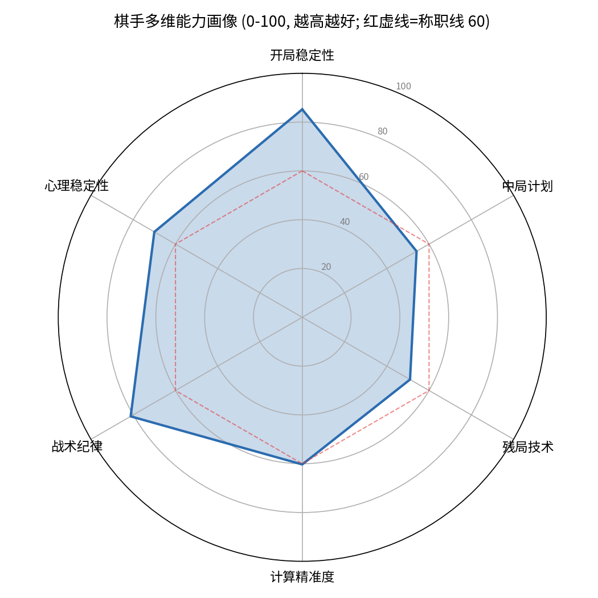

# AI 教练 · 能力画像报告与一周训练计划

> 学员：Student（样例演示数据，3 局，白方）· 分析引擎：Stockfish 16（深度 16，损失 400cp 封顶）
> 报告生成：2026-10-24 · 流水线：analyze.py → profile.py → 本报告（LLM 教练层）

---

## 一、总览

| 指标 | 数值 | 说明 |
|---|---|---|
| 综合精度 | **83.5%** | 逐着与引擎最佳着的接近程度 |
| ACPL | **39.7** | 平均每着损失（封顶后） |
| 五档评级 | **Competent（称职）** | 对应成人进阶带 1200–1800 的典型区间 |
| 走子分布 | Best 42 · Good 41 · Inaccuracy 13 · **Mistake 8 · Blunder 5** | 109 着中约 12% 出现明显损失 |

**一句话结论**：你的开局很扎实，多数时候像个称职的俱乐部棋手；问题集中在**残局技术**和**中局计划**——而且失误不是均匀出现的，是在局面转换和子力交换后"松一口气"的那几着集中爆发的。

## 二、多维能力画像

| 维度 | 得分 | 状态 | 依据 |
|---|---|---|---|
| 开局稳定性 | 85.2 | ✅ 亮点 | 前 8 回合平均损失仅 ~14cp，几乎没有开局失误 |
| 战术纪律 | 81.2 | ✅ 良好 | 送子/漏算频率不高（5 次严重失误 / 109 着） |
| 心理稳定性 | 70.0 | ➖ 样本不足 | 本批样本没有"明显领先且分出胜负"的对局 |
| 计算精准度 | 60.3 | ⚠️ 待提升 | Inaccuracy 偏多（13 着），说明候选着法比较粗糙 |
| 中局计划 | 54.1 | ⚠️ 最弱项 2 | 中局阶段损失占比最高，缺计划、随手感明显 |
| 残局技术 | 51.0 | 🔴 最弱项 1 | 残局阶段两次 150cp+ 失误直接送掉均势 |

**最弱三项（本周训练重点）**：残局技术(51) → 中局计划(54) → 计算精准度(60)。

## 三、关键错误逐着点评（CheckPause 式）

> 只评"这一步"，基于引擎数据，不剧透后续变化。

### 🔴 #1　G2 第43着　Nb1　— Blunder（损失 406cp）
引擎首选：**Bxf6**。类型：主动送子/漏算防御。
这步棋是你全周代价最高的一着：马退回角落的瞬间，己方有子力处于无保护状态，被对手直接白吃，损失约 4 个兵的价值。引擎首选 Bxf6 的思路是先用交换处理掉对方最活跃的子力，再安排后方的马——次序错了，结果完全不同。**以后每次退马/撤子前，先扫一眼：我这步走完后，哪个子没人保护了？**

### 🔴 #2　G3 第25着　Bb3　— Blunder（损失 401cp）
引擎首选：**exd7**。类型：错失战术机会。
局面里送上门的得子机会你没有拿：exd7 可以直接吃到实质子力，而你选择了 Bb3 这步"看起来也在发展"的棋，一步损失 400cp。这类错误的根源往往不是不会算，而是**没把"吃子检查"纳入走子流程**。给自己定一条铁律：每步先问"有没有吃子/将军"，再看别的计划。

### 🔴 #3　G1 第45着　Qxg7+　— Blunder（损失 343cp）
引擎首选：**Nxe7+**。类型：错失战术机会。
同样是"机会摆在桌上却没拿"：Nxe7+ 带将吃子是先手得子，而 Qxg7+ 吃兵反而把主动权交了回去，一步差了 3 个兵的价值。两步都是吃子时，先算**带将军的那个**——将军能争取到时间，让对手没有反手的余地。

### 🟡 #4　G1 第69着　Rad1　— Mistake（损失 182cp，残局）
引擎首选：**f3**。残局里你连续两着（#63 Bxb4、#69 Rad1）都选择了"看起来自然"但让 king 安全性和兵形恶化的走法，合计损失超过 350cp，这正是你残局技术分偏低的主因。残局阶段每个兵的移动都是永久性的，走之前先确认王的舒适度和兵链完整性。这是本周要专项补的模块。

## 四、错题访谈（针对最大失误 Nb1）

> 目的：定位是**计算错**、**知识盲区**还是**习惯问题**。请回答这三个问题：

1. 走 Nb1 之前，你有没有注意到对面某个子正盯着你的某个子？（如果没看到——是没看，还是看到了觉得没事？）
2. 当时你在比较哪几个候选着法？Bxf6 这个交换在不在你的候选清单里？
3. 这步棋你觉得自己属于哪种：**没算到对手的应手**（计算错）/ **不知道该先交换再退马**（知识盲区）/ **走棋太随手**（习惯问题）？

我的初步判断（点开后看）

从模式看更像**习惯问题 + 轻度计算错**：退马本身不是坏想法，坏的是退马的次序——先处理悬空子力再退。这类"次序颠倒"是 1200–1800 带最典型的失分方式，通过强制自查清单（吃子→将军→悬空子）可以在两周内明显改善。

## 五、能力画像小传

三局 109 着、综合精度 83.5%，你是一个**开局靠谱、中残局掉链子**的棋手：开局阶段平均损失只有 14cp，8 次失误里有 7 次发生在中局转换和残局。你最值钱的资产是战术直觉——109 着里只有 5 次严重送子，这个比例在同分段里算干净的。真正拖后腿的是"局面松懈期"：交换完成、威胁暂时解除之后的那一两着，你交了最多的学费（三笔 300cp+ 的失误全是这么来的）。这周不做别的，就练两件事：**残局基本功**和**交换后的"重新扫描"习惯**。

## 六、一周针对性训练计划

> 原则：诊断 → 开方 → 练习 → 复测。每天 20–40 分钟，可拆分。

| 天 | 主题 | 练什么 | 时长 | 验收标准 |
|---|---|---|---|---|
| 周一 | 残局·王兵 | 对王、关键格规则 + 10 题基础王兵残局 | 30min | 10 题对 8 题 |
| 周二 | 中局·计划 | 复盘本报告 G1 的中局段，每步写一句"我的计划是什么" | 30min | 找出自己 3 处"无计划着法" |
| 周三 | 计算·战术 | 15 题战术（强制流程：先报候选着法，再落子） | 25min | 正确率 ≥70% |
| 周四 | 残局·车类 | 卢塞纳/菲利多尔定式 + 8 题车残局 | 30min | 能独立讲出两个定式的思路 |
| 周五 | 中局·交换 | 专项：每次交换完成后，强制"重新扫描"（悬空子/威胁/兵形）再走下一着，用 10 题中局题演练 | 25min | 0 次漏掉悬空子 |
| 周六 | 实战 | 打 1–2 局 15+10 慢棋，唯一目标：**零送子** | 60min | 无 Blunder（引擎复盘验证） |
| 周日 | 复测 | 周六对局上传复盘 + 10 题专项测验（残局5+中局5） | 40min | 见下方量化目标 |

**下周复测量化目标**（用新对局重新跑画像验证）：
- 残局技术：51 → **≥65**
- 中局计划：54 → **≥65**
- 计算精准度：60 → **≥70**（Inaccuracy 数减半）
- 全局：Blunder ≤1 / 3 局（当前 5 / 3 局）

## 七、闭环与记忆库

- 本报告的数据底稿：`analysis.json`（逐着引擎数据）+ `profile.json`（画像）。
- 下次上传新对局后，画像会与本次对比，验证训练效果（"残局题正确率 55%→82%"式的可视化）。
- ⚠️ 本次为**样例演示**（合成对局，学员为"Student"），因此**未写入**你的 WorkBuddy 记忆库；等你用真实对局首次跑通后，技能会把真实画像+训练计划写入记忆库，实现跨会话的长期跟踪。
